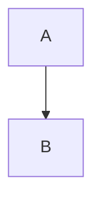

# File Format and Link Rules

Date: 2026-04-03
Status: Draft

## Goal

Lock the canonical Phase 1 note syntax rules before implementation.

## 1. Supported Note File Type

Phase 1 note files:

- `.md`

Other extensions can be considered later through config.

## 2. Frontmatter Format

Use YAML frontmatter at the top of the file.

Canonical structure:

```md
---
id: 01J...
title: Example Note
tags:
  - project/foo
  - type/concept
type: concept
aliases:
  - Example Alias
created: 2026-04-03T10:00:00Z
updated: 2026-04-03T10:00:00Z
source: https://example.com
status: active
---
```

## 3. Required Frontmatter Fields

- `id`
- `title`
- `tags`

## 4. Optional Frontmatter Fields

- `type`
- `aliases`
- `created`
- `updated`
- `source`
- `status`
- `sources` -- list of note IDs this page was derived from (LLM Wiki provenance)

## 5. Supported Tag Syntax In Frontmatter

Preferred canonical form:

```yaml
tags:
  - project/foo
  - rust
```

Phase 1 recommendation:

- accept both YAML list and single string for compatibility
- normalize to YAML list on write

Examples accepted on read:

```yaml
tags: rust
```

```yaml
tags:
  - rust
  - project/foo
```

## 6. Supported Aliases Syntax

Same rule as tags:

- accept string or list on read
- normalize to list on write

## 7. Title Rule

Title must exist in frontmatter after normalization.

Derivation precedence:

1. existing frontmatter `title`
2. first H1 in body
3. filename stem

## 8. H1 Rule

The first H1 is optional in Phase 1.

Reason:

- frontmatter `title` is canonical
- many users still want visible H1, but it should not be mandatory

Possible warning:

- if frontmatter title and first H1 differ materially

## 9. Note Link Syntax

Phase 1 supported wiki link forms:

- `[[Note Title]]`
- `[[Note Title|Alias Text]]`
- `[[path/to/note]]`
- `[[path/to/note|Alias Text]]`

Supported markdown links:

- `[Text](https://example.com)`
- `[Text](./relative/path.md)`

## 10. Link Resolution Precedence

Recommended precedence:

1. exact title match
2. exact alias match
3. file basename match
4. exact relative path match

If multiple matches exist:

- mark ambiguous
- do not silently pick one

## 11. Ambiguous Links

Ambiguous internal links should be warnings.

The index may leave them unresolved until the user fixes them.

## 12. External Links

Treat links with URL schemes like:

- `http`
- `https`

as external links.

## 13. Relative File Links

Markdown relative links to local files should be indexed separately from note wiki-links.

Examples:

- `[diagram](./assets/diagram.png)`
- `[other note](../notes/foo.md)`

These may resolve to:

- asset references
- note references

depending on the target.

## 14. Mermaid

Support fenced mermaid blocks:

```md

```

Phase 1 behavior:

- detect presence
- preserve content unchanged
- count/index block presence optionally

## 15. Asset References

Asset references may appear as:

- markdown image links
- markdown file links
- direct relative paths in supported markdown contexts

Phase 1 should focus on markdown-standard references first.

## 16. Normalized Frontmatter Field Order

Recommended write order:

1. `id`
2. `title`
3. `tags`
4. `type`
5. `aliases`
6. `created`
7. `updated`
8. `source`
9. `status`

## 17. Encoding

Use UTF-8 text files.

## 18. Duplicate IDs

Duplicate note IDs are invalid and must be reported as errors.

## 19. Unknown Frontmatter Keys

Unknown keys should be preserved on read/write if possible.

Reason:

- avoid destructive normalization
- allow future extension

## Open Questions

- whether block links and heading links should be added in Phase 2
- whether inline tags in markdown body should be indexed later
